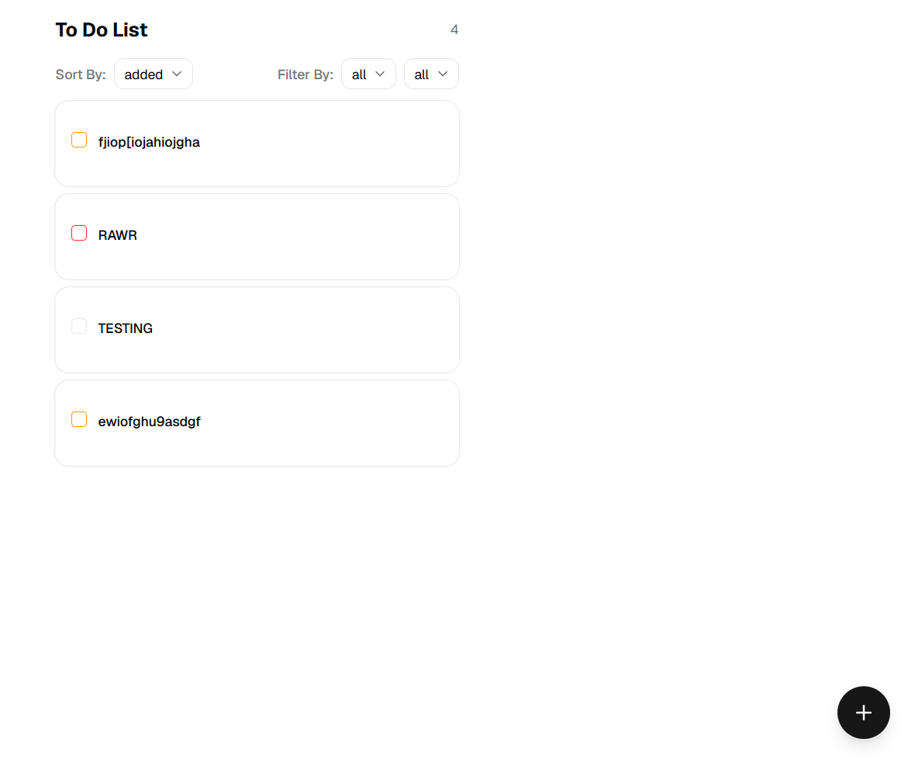
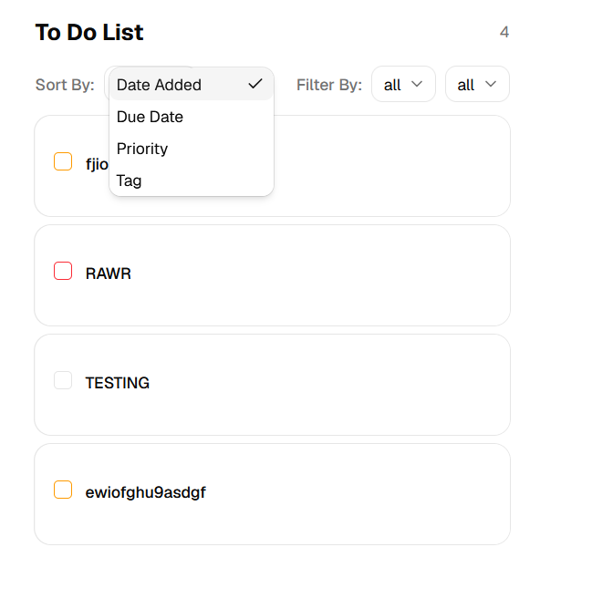
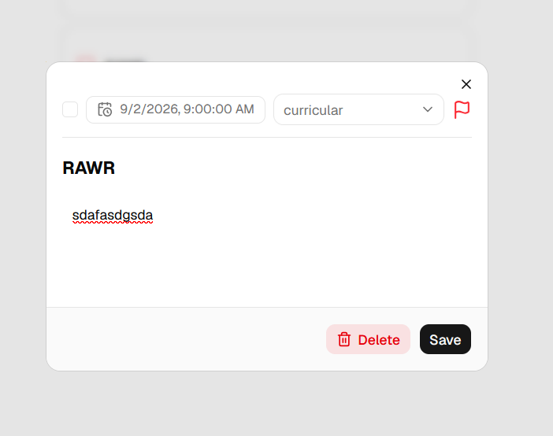

# To-Do List (MERN + TypeScript)

A full-stack to-do list app  tags

## Application description

A full-stack MERN + TypeScript to-do app with **user accounts**. Visitors must
register and log in; the task screen sits behind an authenticated route. Auth
uses a **server-side session** stored in MongoDB with an **httpOnly cookie**, so
a logged-in user stays logged in across refreshes and app restarts. Passwords
are hashed with **argon2**, and password recovery works through an **emailed
reset link** (nodemailer over Gmail SMTP).

## Implemented features

- **Tasks:** create, edit, toggle complete, soft-delete + undo, sort & filter.
- **Register** — email, display name, password (auto-logs you in).
- **Login / Logout** — session created on login, destroyed on logout.
- **Protected routes** — unauthenticated users are redirected to `/login`.
- **Session persistence** — auth state restored from the cookie via `GET /me`.
- **Profile page** — view your name/email (`/profile`).
- **Password recovery** — request a reset link by email, set a new password via
  a one-time, 1-hour-expiry token.
- **Greeting + logout** — `Hello, <name>` on the task screen links to the profile.
- **User-Based Access Control (UBAC)** — every task belongs to a user; the
  backend only returns/modifies tasks the logged-in user owns (or can access
  through a list they're a member of).
- **Collaborative lists** — switch between your **Personal** list and group
  lists. Each user can own one group list, add other users to it by email with a
  `view` or `edit` role, and sees only the lists they own or were added to.

> See `AUTH_FEATURE.md` for the full auth architecture and how the files link.

---

## Activity 3: Multi-user CRUD + UBAC

### How Activity 1 and Activity 2 were merged

Activity 2 (accounts/auth) was built in this same repository directly on top of
the Activity 1 CRUD code, not on a separate `act2-accounts` branch. So there was
no branch-vs-branch merge and no Git merge conflicts to resolve. The
`act3-ubac` branch holds the combined code, and the integration work happened
in the code itself:

| Area | Activity 1 (before) | Activity 3 (after) |
| --- | --- | --- |
| Task schema | no owner | `owner` (ref `User`, required, indexed) + `list` (ref `List`, `null` = personal) |
| Task routes | public | `router.use(checkAuth)`, so every task route needs a session (401 otherwise) |
| Task queries | `Task.find()` (everyone's tasks) | filtered by the session user (`owner: me`) or by list membership |
| Task create | trusted the body | `owner` is always taken from `req.session.userId`, never from the client |
| Frontend task API | plain `fetch` | `credentials: "include"` so the session cookie is sent |
| Login/Register | — | redirect straight to the To-Do List (`/`) |
| New | — | `List` model, `/api/lists` routes, `utils/listAccess.ts`, members dialog + list switcher |

### Schema

Four MongoDB collections. Users are referenced by `_id` only; no user data is
copied into tasks or lists (names/emails are looked up with `populate` when
needed).

```
users                 tasks                         lists
─────                 ─────                         ─────
_id  ◄────────────────owner   (ObjectId, required)   _id  ◄──── tasks.list
email (unique)        list    (ObjectId | null) ───► owner  (ObjectId → users, unique)
name                  title, priority, tag,          name
passwordHash (argon2) due_date, completed,           members: [{ user (→ users), role: "view" | "edit" }]
resetTokenHash        description, deletedAt
resetTokenExpires     createdAt, updatedAt

sessions (connect-mongo): { _id: session id, session: { userId }, expires }
```

- **User 1 ── N Task**: `tasks.owner` → `users._id` (who created it).
- **List 1 ── N Task**: `tasks.list` → `lists._id`; `null` means a personal task.
- **User 1 ── 1 List (owned)**: `lists.owner` is unique, so one group list per user.
- **User N ── N List (membership)**: the `lists.members` array of `{ user, role }`.

### How ownership is checked

All checks run on the **backend**. The UI hiding buttons is only cosmetic.
The logged-in user's id always comes from the session (`req.session.userId`),
never from the request body or URL.

- **Personal task**: allowed only if `task.owner === me`.
- **List task**: `getListRole(listId, me)` in `utils/listAccess.ts` returns
  `"owner"`, `"edit"`, `"view"` or `null`. `null` → **404**, `view` trying to
  modify → **403**.
- **IDOR**: requesting someone else's task or list by changing the id returns
  **404 "not found"**, the same as a task that doesn't exist, so the response
  doesn't even confirm it exists.
- Request bodies are whitelisted by Zod, so a client can't send `owner`, and
  `list` can't be changed after a task is created.

Example: the update/delete/restore guard (`controllers/task.controller.ts`)

```ts
const task = await Task.findById(req.params.id)
if (!task) → 404
if (!task.list) {                       // personal task
  if (!task.owner.equals(me)) → 404     // not mine
} else {
  const role = await getListRole(task.list, me)
  if (role === null) → 404              // not a member of that list
  if (!canEdit(role)) → 403             // view-only member
}
```

---

## Tech stack & why

**MERN + TypeScript**, split into a separate backend and frontend.

| Layer | Choice | Why |
| --- | --- | --- |
| Database | **MongoDB** (local, via Mongoose) | Documents map naturally to a task object; no rigid table setup. **Mongoose** adds a schema (validation) plus typed models, which pairs well with TypeScript. Runs locally so the app works offline with no cloud account. |
| Backend | **Express** | Minimal Setup and have already little experience |
| Language | **TypeScript** (both sides) | Catches shape mistakes at compile time before they become a problem. Run in dev with **tsx** (transpile + watch, no separate build step). |
| Frontend | **React** | My Most used frontend language and has many libraries and imports |
| UI | **Tailwind CSS** + **shadcn/ui** (Base UI) | Prebuilt components and ease of use |
| Routing | **react-router-dom** | Client-side routes for login/register/profile/reset + a protected-route guard. |
| Auth | **express-session** + **connect-mongo** + **argon2** | Server-side session stored in Mongo; browser holds only an opaque **httpOnly** cookie it can't read (XSS-safe). Not JWT. argon2 hashes passwords. |
| Email | **nodemailer** (Gmail SMTP) | Sends the password-reset link. |
| Validation | **Zod** (shared rules both sides) | Same schemas validate the request body on the backend and the forms on the frontend. |
| Forms / data | **TanStack Form** + **TanStack Query** | Form state/validation and server-state fetching/caching. |

**Persistence model:** the React state is only an in-memory cache. The source of
truth is MongoDB — every create/edit/toggle/delete writes to the database via the
API, and on load the frontend refetches from it. Delete is a **soft delete** (a
`deletedAt` flag), so it persists immediately *and* can be undone without
re-creating the task.

---

## Prerequisites

- **Node.js** 20+ (developed on v24)
- **pnpm** 10+ (`npm i -g pnpm`) — this is a **pnpm workspace** (one lockfile, two packages)
- **MongoDB Community** running locally (this project uses port **27018**)
- A **Gmail App Password** (only needed for password-recovery email) — 2-Step
  Verification on, then generate one at myaccount.google.com/apppasswords

---

## Setup & run locally

The app is two processes (backend + frontend) plus a local MongoDB. Run each in
its own terminal.

### 1. Start MongoDB (port 27018) Had to do this since 27017 is blocked by dorm wifi firewall

```bash
sudo systemctl start mongod && ss -tln | grep 27018 && echo "mongo up ✓"
```

### 2. Install dependencies (once, from the repo root)

Because this is a pnpm workspace, a single install at the root covers both the
backend and the frontend:

```bash
pnpm install
```

### 3. Backend

```bash
# create backend/.env  (see the table below for all keys)
#   MONGO_URI=mongodb://localhost:27018/todoapp
#   PORT=5000
#   SESSION_SECRET=<any long random string>
#   CORS_ORIGIN=http://localhost:5173
#   SMTP_HOST=smtp.gmail.com
#   SMTP_PORT=587
#   SMTP_USER=you@gmail.com
#   SMTP_PASS=<16-char Gmail App Password>
#   FRONTEND_URL=http://localhost:5173

cd backend
pnpm dev          # tsx watch → http://localhost:5000
```

### 4. Frontend

```bash
# create frontend/.env :
#   VITE_API_URL=http://localhost:5000/api/tasks
#   VITE_AUTH_URL=http://localhost:5000/api/auth
#   VITE_LISTS_URL=http://localhost:5000/api/lists   (optional, this is the default)

cd frontend
pnpm dev          # vite → http://localhost:5173
```

Open **http://localhost:5173** — with no session you land on `/login`.

### Environment variables

| File | Key | Example |
| --- | --- | --- |
| `backend/.env` | `MONGO_URI` | `mongodb://localhost:27018/todoapp` |
| `backend/.env` | `PORT` | `5000` |
| `backend/.env` | `SESSION_SECRET` | any long random string (signs the session cookie) |
| `backend/.env` | `CORS_ORIGIN` | `http://localhost:5173` |
| `backend/.env` | `SMTP_HOST` / `SMTP_PORT` | `smtp.gmail.com` / `587` |
| `backend/.env` | `SMTP_USER` / `SMTP_PASS` | your Gmail / 16-char App Password |
| `backend/.env` | `FRONTEND_URL` | `http://localhost:5173` (builds the reset link) |
| `frontend/.env` | `VITE_API_URL` | `http://localhost:5000/api/tasks` |
| `frontend/.env` | `VITE_AUTH_URL` | `http://localhost:5000/api/auth` |
| `frontend/.env` | `VITE_LISTS_URL` | `http://localhost:5000/api/lists` (optional, this is the default) |

> If `SMTP_USER`/`SMTP_PASS` are left empty, the reset email isn't sent — instead
> the backend **logs the reset link to the console**, which is handy in dev.

### Database setup

No migrations or seeds needed. MongoDB + Mongoose create the `todoapp` database
and its `users` / `tasks` / `lists` / `sessions` collections automatically on first write. Just have
`mongod` running on port 27018.

---

## API endpoints (REST)

Base URL: `http://localhost:5000/api/tasks`. Every task route requires a
session (`401` otherwise).

| Method | Path | Description | Ownership check |
| --- | --- | --- | --- |
| `GET` | `/api/tasks` | My active **personal** tasks, newest first | query filtered by `owner: me, list: null` |
| `GET` | `/api/tasks?list=<id>` | Active tasks in a group list | must be owner or member, else `404` |
| `POST` | `/api/tasks` | Create a task (optional `list`) | `owner` set from session; with `list`: owner/`edit` only (`403` for `view`, `404` for non-member) |
| `PUT` | `/api/tasks/:id` | Update a task (title, completed, priority, tag, due date, description) | personal: must be owner; list: owner/`edit` |
| `DELETE` | `/api/tasks/:id` | Soft-delete a task (sets `deletedAt`) | same as `PUT` |
| `PATCH` | `/api/tasks/:id/restore` | Undo a soft-delete (clears `deletedAt`) | same as `PUT` |

### List endpoints

Base URL: `http://localhost:5000/api/lists`. Every route requires a session.

| Method | Path | Body | Description | Ownership check |
| --- | --- | --- | --- | --- |
| `GET` | `/api/lists` | — | Lists I own or was added to, plus `myRole` | query `$or: [{ owner: me }, { "members.user": me }]` |
| `POST` | `/api/lists` | `{ name }` | Create my group list | `owner` from session; second list → `409` |
| `POST` | `/api/lists/:id/members` | `{ email, role }` | Add a user by email as `view`/`edit` | list owner only (`403` member, `404` non-member) |
| `PATCH` | `/api/lists/:id/members/:userId` | `{ role }` | Change a member's role | list owner only |
| `DELETE` | `/api/lists/:id/members/:userId` | — | Remove a member | list owner only |

Try the IDOR check yourself: log in as user B and request user A's task id.
The response is `404 Task not Found`, not A's data:

```bash
curl -b jarB.txt -X PUT localhost:5000/api/tasks/<A's task id> \
  -H 'Content-Type: application/json' -d '{"title":"hacked"}'
# → 404 {"message":"Task not Found"}
```

### Auth endpoints

Base URL: `http://localhost:5000/api/auth`. All browser calls send
`credentials: "include"` so the session cookie travels both ways.

| Method | Path | Body | Description |
| --- | --- | --- | --- |
| `POST` | `/api/auth/register` | `{ name, email, password }` | Create account, hash password, **start a session (auto-login)** |
| `POST` | `/api/auth/login` | `{ email, password }` | Verify password, start a session |
| `GET` | `/api/auth/me` | — | Who is the current session? Returns the user or `401` |
| `POST` | `/api/auth/logout` | — | Destroy the session, clear the cookie |
| `POST` | `/api/auth/forgot-password` | `{ email }` | Email a reset link; always replies `200` (no account enumeration) |
| `POST` | `/api/auth/reset-password` | `{ token, password }` | Set a new password with a valid, non-expired token |

Quick cURL (cookie jar keeps the session across calls):

```bash
# register (also logs in, saving the cookie)
curl -c jar.txt -X POST localhost:5000/api/auth/register \
  -H 'Content-Type: application/json' \
  -d '{"name":"Ana","email":"ana@x.com","password":"password123"}'

# who am I? (sends the cookie back)
curl -b jar.txt localhost:5000/api/auth/me

# log out
curl -b jar.txt -X POST localhost:5000/api/auth/logout
```

---

## Session mechanism

- On **login/register**, the server saves `req.session.userId` and sends back a
  **signed, httpOnly cookie** (`connect.sid`). The session itself lives in
  MongoDB via **connect-mongo** (`sessions` collection, 14-day TTL); the browser
  only holds the opaque cookie and cannot read it (safe from XSS).
- On every app load, the frontend calls `GET /api/auth/me`; the browser auto-
  sends the cookie, the server reads the session and returns the user — this is
  what keeps you logged in across **refresh and app restart** (the session is a
  real server record, not an in-memory variable).
- **Logout** calls `req.session.destroy()` and clears the cookie, so protected
  pages are no longer reachable.
- The React side mirrors this in an `AuthContext`; a `ProtectedRoute` redirects
  to `/login` whenever there's no user.

## Password-recovery mechanism

1. User submits their email on `/forgot-password` → `POST /forgot-password`.
2. Server generates a random token (`crypto.randomBytes`), stores **only its
   SHA-256 hash** + a **1-hour expiry** on the user, and emails the **raw** token
   as a link: `FRONTEND_URL/reset-password?token=<raw>` (via nodemailer / Gmail).
   The response is always a generic success so you can't probe which emails exist.
3. User opens the link → `/reset-password` reads `?token=` → submits a new
   password → `POST /reset-password { token, password }`.
4. Server hashes the incoming token, finds a user with a matching, **non-expired**
   hash, sets the new argon2 password, and **clears the token** (single-use).

Storing only the token hash means a database leak can't be used to reset
accounts; expiry + single-use limit the window further.

---

## Project structure

```
backend/src/
  server.ts                  app entry (CORS, session, routes)
  config/db.ts               MongoDB connection
  config/mailer.ts           nodemailer transport + sendResetEmail
  schemas/task.schema.ts     Mongoose schema + enums (owner + list refs)
  schemas/user.schema.ts     user model fields (+ reset token hash/expiry)
  schemas/list.schema.ts     Mongoose list schema (owner + members/roles)
  schemas/auth.schema.ts     Zod request validation (register/login/reset)
  schemas/listInput.schema.ts  Zod request validation for /api/lists
  models/Task.ts             Mongoose model
  models/List.ts             Mongoose model
  controllers/task.controller.ts  task handlers (CRUD + restore) with ownership checks
  controllers/list.controller.ts  list handlers (my lists, create, owner-only members)
  controllers/auth.controller.ts  auth handlers (register/login/me/logout/reset)
  middleware/requireAuth.ts  checkAuth (401 if no session)
  utils/listAccess.ts        getListRole / canEdit (single source of list access)
  routes/task.routes.ts      task REST routes
  routes/list.routes.ts      list REST routes
  routes/auth.routes.ts      auth routes

frontend/src/
  pages/TasksPage.tsx        main screen (list, editor, sort/filter, greeting + logout)
  pages/LoginPage.tsx        login form
  pages/RegisterPage.tsx     register form
  pages/ForgotPasswordPage.tsx  request a reset link
  pages/ResetPasswordPage.tsx   set a new password (reads ?token=)
  pages/ProfilePage.tsx      view name/email
  context/AuthContext.tsx    auth state + session restore
  components/ProtectedRoute.tsx  redirects to /login when logged out
  components/TaskCard.tsx     one task row
  components/MembersDialog.tsx  owner adds/removes members, changes roles
  components/ui/*             shadcn components
  hooks/useTasks.ts          tasks state + all DB operations
  hooks/useLists.ts          my lists + create group list
  api/tasks.ts               task fetch calls
  api/lists.ts               list fetch calls
  api/auth.ts                auth fetch calls (credentials: include)
  lib/authSchema.ts          Zod form schemas (shared rules with backend)
  types/                     shared TypeScript types
  lib/                       helpers (dates, tags, priority)
```


## Screenshots





