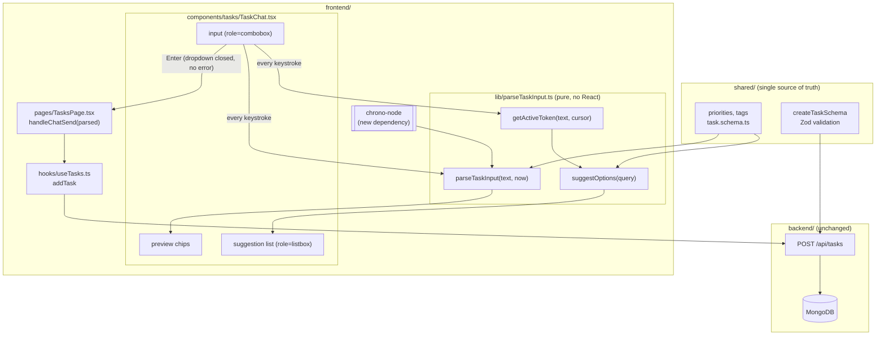
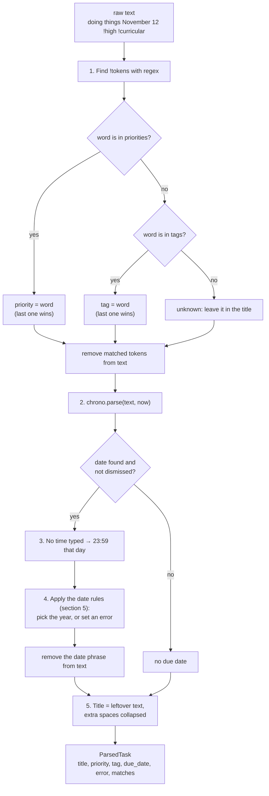
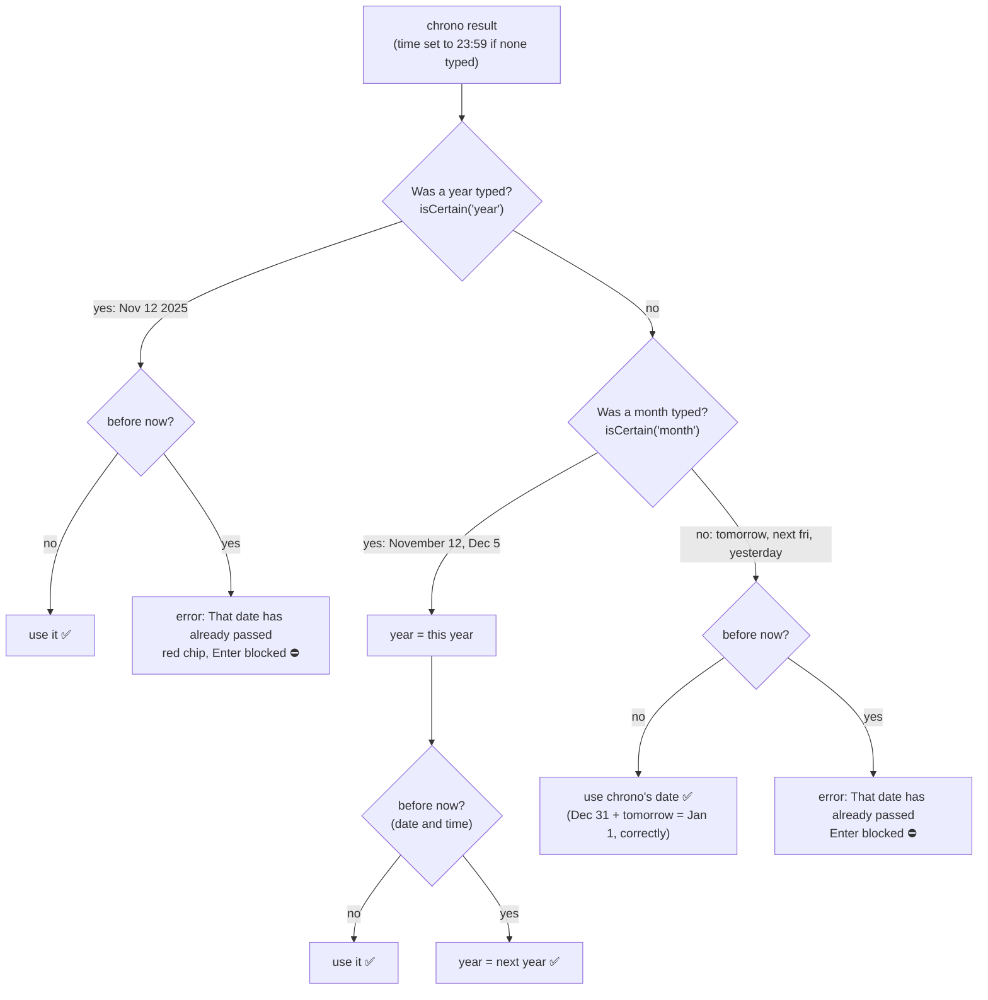
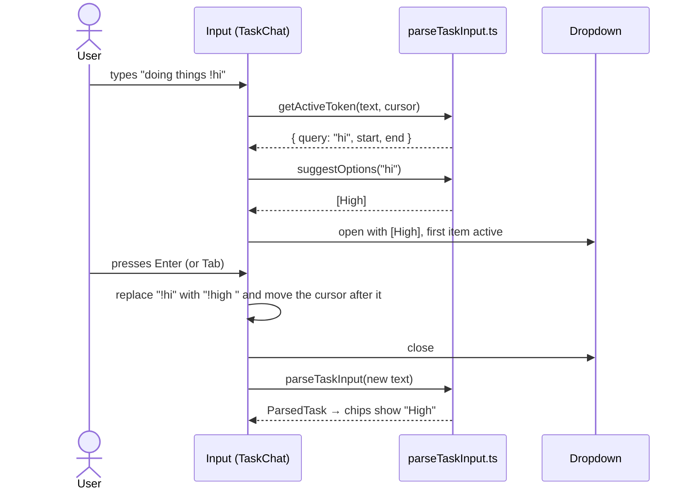
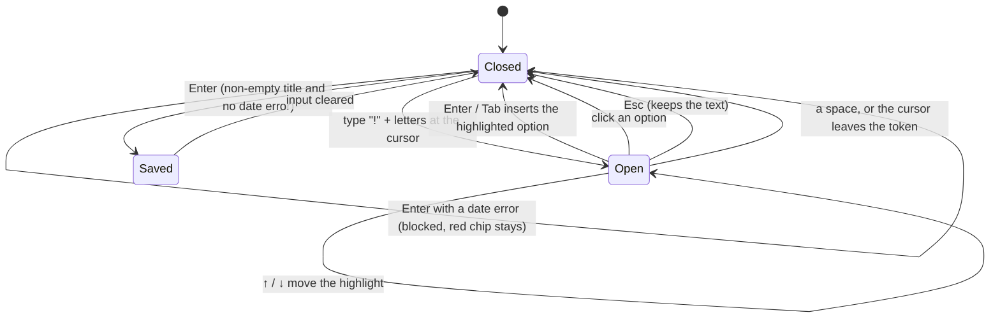

# Smart task input (NLP parsing + `!` autocomplete) — architecture plan

Status: **built.** Parser: `frontend/src/lib/parseTaskInput.ts`
(25 unit tests, `pnpm test`). UI: `frontend/src/components/tasks/TaskChat.tsx`.

Type a task the way you'd say it, and the app pulls out the due date, priority
and tag:

```
doing things November 12 !high !curricular
→ title: "doing things"   due: the next Nov 12, 23:59   priority: High   tag: Curricular
```

Typing `!` opens a dropdown that narrows as you type (`!hi` → **High**).

---

## 1. Decision: regex for tokens + chrono-node for dates

The message mixes two different parsing problems:

| Part | Kind of problem | Tool |
|------|-----------------|------|
| `!high`, `!curricular` | A fixed syntax we invent (a marker plus a word from a known list) | **Regex** |
| `November 12`, `tomorrow 3pm`, `next fri`, `in 2 days` | Free-form natural language | **chrono-node** (date-parsing library) |

| | Regex only | **Regex + chrono (chosen)** | LLM API |
|---|---|---|---|
| `!tokens` | ✅ | ✅ | ✅ |
| "next fri 3pm", "in 2 days" | ❌ unless we write a date parser | ✅ | ✅ |
| Instant dropdown on every keystroke | ✅ | ✅ | ❌ network round-trip |
| Offline, free, same result every time | ✅ | ✅ | ❌ |

- The dropdown has to react on every keystroke, so parsing runs **in the browser**.
- chrono returns the date **and where it was found in the text** (`index` and
  `text`), which is what lets us cut it out of the title.

---

## 2. Syntax

| What | Syntax | Rule |
|------|--------|------|
| Priority | `!high` `!medium` `!low` | Must be at the start or after a space, followed by letters. Last one wins. |
| Tag | `!curricular` `!extra-curricular` `!home` | **Decided:** same `!` marker as priority; the names never overlap. |
| Due date | Any phrase chrono understands | The first date found is used. |
| Title | Whatever is left | Tokens and the date phrase are removed; extra spaces are collapsed. |

The token regex anchors on whitespace, so `Learn C!` and `wow!!` are left alone:
```ts
/(?:^|\s)!([a-z-]+)/gi   // tokens anywhere in the text (for parsing)
/(?:^|\s)!([a-z-]*)$/i   // the token right before the cursor (for autocomplete)
```

---

## 3. Architecture overview



**Who does what**
- **`parseTaskInput.ts`:** all parsing logic, as plain functions with no React,
  so it can be unit-tested with input → output pairs.
- **`TaskChat.tsx`:** UI only. It shows the input, the dropdown and the preview
  chips, and calls `onSend(parsed)`.
- **`TasksPage.tsx`:** turns the parsed result into an `addTask` call.
- **Backend:** no change. `createTaskSchema` already validates title, priority,
  tag and due date.

---

## 4. Parse pipeline: `parseTaskInput(text, now)`



The output shape (types come from `shared/`):

```ts
type Match = { kind: "priority" | "tag" | "date"; text: string; start: number; end: number };

type ParsedTask = {
  title: string;          // leftover text; empty means it can't be saved
  priority?: Priority;    // "low" | "medium" | "high"
  tag?: Tag;              // "curricular" | "extra-curricular" | "home"
  due_date?: Date;        // a date with no time typed → 23:59 that day
  error?: string;         // set → red chip and Enter is blocked (section 5)
  matches: Match[];       // what was recognized, for the chips
};
```

---

## 5. Date rules: which year, and when to block

**Decided:**
1. **No year typed:** use **this year**. If that date and time has **already
   passed** (including a time earlier today), use **next year** instead, so the
   date always means the next upcoming one.
2. **Year typed, and the date is in the past:** show an **error**, and Enter
   can't save the task.
3. **No time typed:** the task is due at **23:59** that day (Q2).

chrono can't be left to pick the year. By default it picks the year that makes
the date **closest** to today, so "November 12" typed on Nov 22 would give Nov
12, 2026, which is 10 days ago. So after chrono parses, we check which parts the
user actually typed. chrono's `isCertain("year")` / `isCertain("month")` tell us
that, and we pick the year ourselves when it was only guessed.



Examples, with now = **Nov 22, 2026, 2:00 pm**:

| Typed | Result | Why |
|-------|--------|-----|
| `December 5` | Dec 5, **2026** 23:59 ✅ | No year → this year; still ahead |
| `November 12` | Nov 12, **2027** 23:59 ✅ | No year → this year is past → **next year** |
| `January 5` | Jan 5, **2027** 23:59 ✅ | Same rule: Jan 5, 2026 is past → next year |
| `November 22` (today) | Nov 22, 2026 23:59 ✅ | The default 23:59 is still ahead |
| `Nov 22 9am` (today) | Nov 22, **2027** 09:00 ✅ | No year, and 9am today has already passed → next year (Q7) |
| `Jan 5 2027` | Jan 5, 2027 23:59 ✅ | Year typed and in the future → kept |
| `Nov 12 2026` | ⛔ "That date has already passed" | Year typed and in the past → error, can't save |
| `tomorrow 3pm` | Nov 23, 2026 15:00 ✅ | Relative date: the year rules don't apply |
| `yesterday` | ⛔ "That date has already passed" | A relative date in the past → error |

**Verified against chrono-node 2.10 (and covered by unit tests):**
- "November 12", "Dec 5", "11/12": `month` certain, `year` not, so they take
  the "no year typed" branch ✅
- "tomorrow", "yesterday", "in 2 days": chrono reports `year` as **certain**, so
  they're handled like "year typed". That gives the intended result: in the past
  → error.
- Weekdays ("friday"): chrono picks **last** Friday by default. We pass
  `{ forwardDate: true }` so it means the upcoming one.
- No time typed: chrono fills in 12:00 or the current time; we replace that
  with 23:59 **before** the past check, so "Nov 22" typed today stays today.
- Time only (`at 3`): chrono reads it as 3 **am**, which becomes tomorrow 3:00
  am if that's already passed today. The chip shows it, and ✕ removes it.
- Bundle cost: about **13 KB gzipped** (46 KB minified).

---

## 6. `!` autocomplete

### Flow on each keystroke



### Matching ("infer from the spelling")
1. **Prefix** match first: `h` → High; `c` → Curricular; `ex` → Extra-curricular.
2. If nothing matches by prefix, fall back to **contains**: `ri` → Curricular,
   Extra-curricular. (`cur` gives only Curricular, because it's a prefix.)
3. `!` alone shows all six, grouped as **Priority** then **Tag**.
4. No matches → the dropdown closes, and the text stays as typed.

### Keyboard (dropdown state)



The key rule: **while the dropdown is open, Enter picks the suggestion. It does
not save the task.**

### Accessibility
- The input gets `role="combobox"`, `aria-expanded`, `aria-controls` and
  `aria-activedescendant` (pointing at the highlighted option).
- The list is `role="listbox"`, with `role="option"` and `aria-selected` on each
  item.
- It's a small custom list rather than shadcn/Base UI's Combobox, because that
  component treats the **whole input** as one value. We need suggestions for
  **one word in the middle** of the text.

---

## 7. Preview chips (check before saving)

```
[ doing things November 12 !high !curricular            ]
  📅 Nov 12, 2026 ✕   🔴 High ✕   🏷 Curricular ✕
```
- These show what the parser understood **before** Enter is pressed, so the user
  can see what will be saved.
- **✕ on the date chip** means "this isn't a date". The words go back into the
  title. This fixes false matches like "Call **May**".
- ✕ on a priority or tag chip removes that token from the text.
- If `error` is set (section 5), the date chip turns **red** and shows the
  message, for example `📅 Nov 12, 2026 · That date has already passed`.
  **Enter doesn't save** until the date is fixed or dismissed with ✕. The
  message is also announced to screen readers (`aria-live`).

---

## 8. Files

| File | Change |
|------|--------|
| `frontend/src/lib/parseTaskInput.ts` | **New:** `parseTaskInput`, `getActiveToken`, `suggestOptions` |
| `frontend/src/lib/parseTaskInput.test.ts` | **New:** unit tests (if Q4 = yes) |
| `frontend/src/components/tasks/TaskChat.tsx` | Add the dropdown, chips and keyboard handling; `onSend(parsed)` instead of `onSend(text)` |
| `frontend/src/pages/TasksPage.tsx` | `handleChatSend(parsed)` → `addTask({ title, priority: parsed.priority ?? "medium", tag, due_date })` |
| `frontend/package.json` | Add `chrono-node` (Q3), and `vitest` as a dev dependency (Q4) |
| Backend, `shared/` | **No change** |

---

## 9. Edge cases

| Input | Result |
|-------|--------|
| `!urgent` (unknown) | Stays in the title as text; no chip |
| `!high !low` | The last one wins → Low |
| `!high` alone | Title is empty → not saved; "Title is required" |
| `Learn C!`, `wow!!` | Not tokens (no letters after `!`, or no space before it) |
| `Call May` | May be read as a date → the user dismisses it with ✕ on the chip |
| No `!priority` | Defaults to Medium, the same as today |
| Two dates (`Nov 12 or Nov 14`) | The first one is used; the second stays in the title |

---

## 10. Testing plan
- **Unit tests for `parseTaskInput.ts`** with a fixed `now` (Nov 22, 2026), so
  date results never depend on the day the tests run. They'd cover every row in
  sections 5 and 9, plus autocomplete matching.
- **Manual browser check** of the dropdown: keyboard, mouse, Enter-picks vs
  Enter-saves, and the chips.
- **curl** against `POST /api/tasks` with parsed payloads (as in the
  change-password work).

---

## 11. Decisions and open questions

### Decided
| # | Question | Decision |
|---|----------|----------|
| Q1 | Marker for priority and tags | **`!` for both** |
| Q2 | Date with no time | **23:59** that day |
| Q3 | Add the `chrono-node` dependency? | **Yes** |
| Q4 | Add Vitest (dev only) for parser tests? | **Yes** |
| Q5 | Shortcuts beyond prefix matching? | **None** |
| Q6 | Date has already passed | **No year typed:** next year. **Year typed:** error, Enter blocked. **Relative date in the past** (`yesterday`): error, Enter blocked. (Section 5) |
| Q7 | Today's date with a typed time that has already passed (`Nov 22 9am` at 2pm) | **Next year**, the same as any past date with no year typed |
